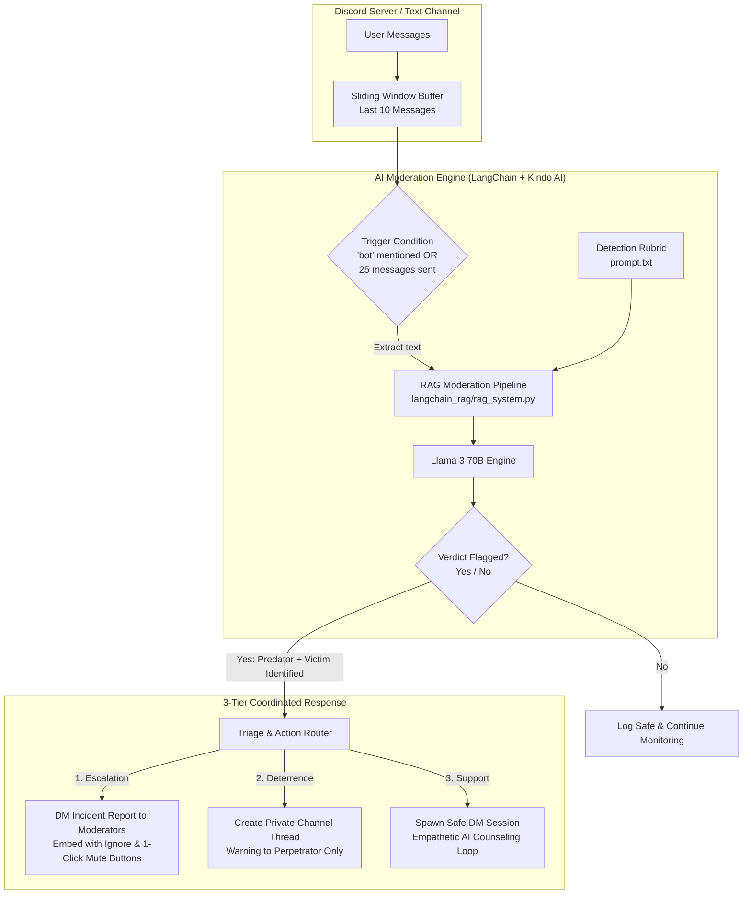

<div align="center">

# 🛡️ Baymod: Autonomous Online Safety & Anti-Grooming Guardian

**An intelligent, LLM-powered Discord moderation bot engineered to detect grooming, predation, and manipulation in online communities.**

[](https://python.org)
[](https://discordpy.readthedocs.io/)
[](https://langchain.com)
[](https://kindo.ai)
[](https://github.com/Ken-1412)
[](#-ownership--contact)

</div>

---

## 📖 Table of Contents

- [The Mission & Problem](#-the-mission--problem)
- [System Architecture](#-system-architecture)
- [How It Works (Workflow Pipeline)](#-how-it-works-workflow-pipeline)
- [Core Features & 3-Tier Intervention](#-core-features--3-tier-intervention)
- [Project Directory Structure](#-project-directory-structure)
- [Prompt Engineering Architecture](#-prompt-engineering-architecture)
- [Prerequisites & Discord Setup](#-prerequisites--discord-setup)
- [Installation & Quick Start](#-installation--quick-start)
- [Environment Configuration](#-environment-configuration)
- [Usage & Testing Walkthrough](#-usage--testing-walkthrough)
- [Ethical Safety & Privacy](#-ethical-safety--privacy)
- [Future Roadmap](#-future-roadmap)
- [Ownership & Contact](#-ownership--contact)

---

## 🎯 The Mission & Problem

Traditional moderation bots rely on **static regexes, profanity blocklists, or keyword filters**. These methods fail completely against sophisticated online predators:

* **Keyword avoidance:** Groomers frequently use friendly, non-explicit language to build trust and isolate young people over time.
* **Context blindness:** Static filters cannot distinguish between friendly banter and manipulative isolation tactics.
* **Lack of victim support:** Traditional bots merely ban or delete messages without providing psychological support or deterring offenders safely.

**Baymod** solves this by leveraging high-capacity Large Language Models (LLMs) with behavioral psychology rubrics to analyze the **conversational trajectory** of text channels. When malicious patterns appear, Baymod executes a coordinated, multi-action safety protocol.

---

## 🏗️ System Architecture



---

## 🔄 How It Works (Workflow Pipeline)

1. **Continuous Ingestion**: The bot listens to chat events on servers via the Discord Gateway.
2. **Context Window Assembly**: Rather than judging single isolated messages, Baymod compiles a sliding window of the last 10 messages in chronological order.
3. **Behavioral Analysis**: The conversation is formatted into an evaluation prompt incorporating clinical indicators of online grooming (personal data probing, isolation, boundary testing, vulnerability targeting).
4. **Structured Decision Extraction**: The LLM outputs a concise 4-line standardized evaluation:
   - Line 1: `yes` / `no` (Moderation required)
   - Line 2: Suspected predator username
   - Line 3: Suspected victim username
   - Line 4: Contextual behavioral reasoning
5. **Simultaneous Tri-Action Protocol**: If flagged `yes`, the bot triggers 3 automated actions simultaneously without leaking sensitive details publicly.

---

## ⚡ Core Features & 3-Tier Intervention

### 1. 🚨 Moderator Incident Escalation
* **Rich Embed Dispatch**: Sends an immediate red-flagged incident report directly to designated moderator accounts (`MODERATORS`).
* **Interactive UI Components**:
  * **[Take Action]**: Instantly assigns a server `Muted` role to the perpetrator, denying send permissions across channels for a 5-minute cooldown.
  * **[Ignore]**: Acknowledges and dismisses the alert ephemerally.
* **Direct Jump Link**: Provides a clickable Discord hyperlink directly to the first offending message for human review.

### 2. ⚠️ Discreet Offender Warning
* Automatically creates an invite-locked, private thread inside the channel visible **only to the bot and the perpetrator**.
* Issues a non-public, firm warning alerting them that suspicious conversational patterns have been flagged, deterring further attempts without causing server-wide panic.

### 3. 💬 Compassionate Victim Support Loop
* Opens a direct message (DM) session with the flagged victim.
* Powered by [`counsel_prompt.txt`](file:///d:/Downloads/Baymod/baymod/counsel_prompt.txt), the bot adopts the persona of a warm, trauma-informed counselor/moderator.
* Maintains dynamic multi-turn conversation memory, allowing the victim to talk through their feelings, receive safety guidance, or end the session whenever ready.

---

## 📂 Project Directory Structure

```plaintext
Baymod/
├── .gitignore                       # Root Git ignore rules (cache, tokens, IDE settings)
└── baymod/                          # Core application package
    ├── .env.example                 # Environment configuration template
    ├── .gitignore                   # Package-level ignore rules
    ├── README.md                    # Project documentation & reference
    ├── requirements.txt             # Python dependencies
    ├── main.py                      # Application bootstrap & entry point
    │
    ├── prompt.txt                   # LLM prompt criteria for grooming detection
    ├── counsel_prompt.txt           # Empathetic counseling persona instructions
    │
    ├── discord_bot/                 # Discord interface layer
    │   ├── __init__.py
    │   └── bot_logic.py             # Event handlers, UI buttons, muting & DM dispatch
    │
    ├── langchain_rag/               # AI reasoning layer
    │   ├── __init__.py
    │   └── rag_system.py            # LangChain integration & Kindo ChatModel wrapper
    │
    └── prototypes / experimental/
        ├── working.py               # Monolithic prototype script (reference)
        └── langtest.py              # LangChain memory experimentation script
```

### Key Source Files Explained

| File | Purpose |
|---|---|
| [`main.py`](file:///d:/Downloads/Baymod/baymod/main.py) | Reads environment variables and runs the Discord bot client. |
| [`discord_bot/bot_logic.py`](file:///d:/Downloads/Baymod/baymod/discord_bot/bot_logic.py) | Manages Discord API connections, message buffers, moderator DMs, button callbacks, and muting logic. |
| [`langchain_rag/rag_system.py`](file:///d:/Downloads/Baymod/baymod/langchain_rag/rag_system.py) | Connects to Kindo LLM (Llama 3 70B) via a custom `BaseChatModel` and runs prompt chains. |
| [`prompt.txt`](file:///d:/Downloads/Baymod/baymod/prompt.txt) | Detailed safety rubric defining grooming traits and specifying structured output formats. |
| [`counsel_prompt.txt`](file:///d:/Downloads/Baymod/baymod/counsel_prompt.txt) | Instructions for the empathetic supportive counselor persona for victim DMs. |

---

## 🧠 Prompt Engineering Architecture

The detection system utilizes a two-tier specialized prompting design:

### A. Grooming Detection Rubric ([`prompt.txt`](file:///d:/Downloads/Baymod/baymod/prompt.txt))
* **Grooming Indicators Covered:**
  - Demographic & relationship interrogation
  - Attempts to isolate to other platforms (Snapchat, Instagram, private calls)
  - Probing for psychological weaknesses (loneliness, fractured family dynamics)
  - Premature intimacy, flattery, and sexualized language
* **Strict Output Format Enforcement:**
  ```
  [yes or no]
  [username of perpetrator]
  [username of victim]
  [1-2 sentence concise explanation]
  ```

### B. Trauma-Informed Counseling ([`counsel_prompt.txt`](file:///d:/Downloads/Baymod/baymod/counsel_prompt.txt))
* Operates under supportive social worker and developmental psychologist guidelines.
* Avoids repeating explicit details back to the victim.
* Focuses on boundary-setting, safety affirmation, and validating feelings in a gentle tone.

---

## 📋 Prerequisites & Discord Setup

### 1. Requirements
* **Python**: Version 3.10 or higher
* **Discord Bot Token**: From [Discord Developer Portal](https://discord.com/developers/applications)
* **Kindo AI API Key**: For LLM inference (Llama 3 70B)

### 2. Discord Developer Portal Setup
1. Create a **New Application** and navigate to the **Bot** tab.
2. Enable the following **Privileged Gateway Intents**:
   - ✅ **Message Content Intent** (Required to read conversation context)
   - ✅ **Server Members Intent** (Required to identify and DM users/moderators)
3. Under **OAuth2 -> URL Generator**, grant:
   - Scopes: `bot`
   - Bot Permissions:
     - `Manage Roles` (for muting)
     - `Create Public/Private Threads`
     - `Send Messages`
     - `Read Message History`
4. Use the generated URL to invite Baymod to your testing server.

---

## 🚀 Installation & Quick Start

### 1. Clone the Repository
```bash
git clone https://github.com/Ken-1412/Baymod.git
cd Baymod/baymod
```

### 2. Set Up a Virtual Environment
```bash
# Windows (PowerShell)
python -m venv venv
.\venv\Scripts\Activate.ps1

# Linux / macOS
python3 -m venv venv
source venv/bin/activate
```

### 3. Install Dependencies
```bash
pip install -r requirements.txt
```

---

## ⚙️ Environment Configuration

Copy `.env.example` to `.env` in the `baymod/` folder:

```bash
cp .env.example .env
```

Fill in your configuration variables in `.env`:

```env
# Discord Bot Token (From Discord Developer Portal)
DISCORD_TOKEN=your_discord_bot_token_here

# Kindo AI LLM API Key
KINDO_API_KEY=your_kindo_api_key_here

# Optional: Hugging Face API Key (if using alternative models)
HUGGING_FACE_API_KEY=your_huggingface_key_here

# Comma-separated Discord usernames of moderators who receive incident reports
MODERATORS=Ketan Singh
```

---

## 🧪 Usage & Testing Walkthrough

### Starting the Bot
```bash
python main.py
```
You should see:
```plaintext
Logged in as Baymod#1234
```

### Testing Moderation in Discord
1. Create a text channel on your server (e.g. `#moderation-test`).
2. Simulate a conversation containing concerning behavior (e.g., asking for personal addresses, attempts to isolate).
3. Mention the word `bot` or allow 25 messages to pass.
4. Observe the terminal output:
   ```plaintext
   Scanning now..
   Sending messages to AI...
   result is: yes predator is SuspectUser victim is TargetUser
   Sending report...
   Engaging victim now...
   ```
5. Check the Moderator's DMs for the **Incident Embed** with the action buttons.
6. Check the perpetrator's channel for the **Private Warning Thread**.
7. Check the victim's DMs for the **Supportive Counseling Message**.

---

## 🛡️ Ethical Safety & Privacy

* **Human-in-the-Loop**: Baymod assists human moderators rather than replacing them. High-consequence actions (e.g., permanent bans) remain under moderator authority.
* **Ephemeral Data Handling**: Conversations are inspected within temporary in-memory buffers and are not persisted to external databases.
* **Discreet Interventions**: Moderation reports and counseling take place via private channels to prevent public shaming or revictimization.

---

## 🗺️ Future Roadmap

- [ ] Multi-platform SDK support (Telegram, WhatsApp Communities)
- [ ] Multilingual safety rubrics (Spanish, Hindi, French)
- [ ] Integration with open-weights local LLMs (Ollama / vLLM)
- [ ] Web dashboard for incident log analytics and case reviews

---

## 👤 Ownership & Contact

* **Project Lead & Owner:** **Ketan Singh**
* **Repository:** [https://github.com/Ken-1412/Baymod](https://github.com/Ken-1412/Baymod)
* **GitHub Profile:** [@Ken-1412](https://github.com/Ken-1412)
* **License:** Proprietary — All rights reserved.
